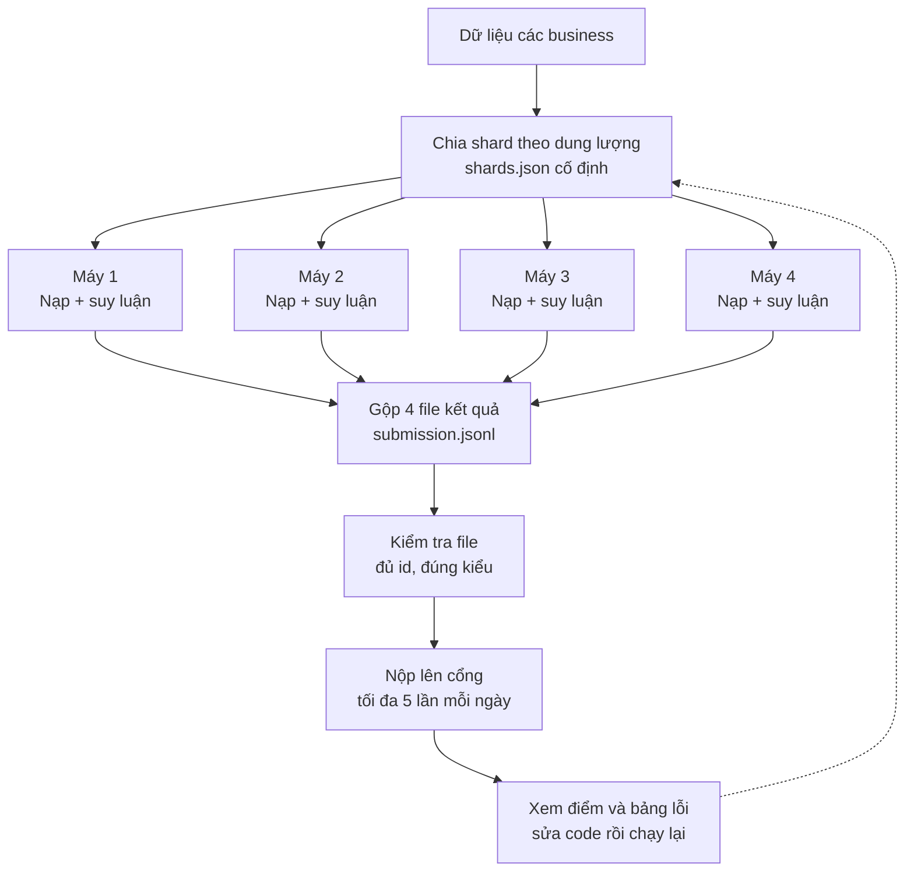
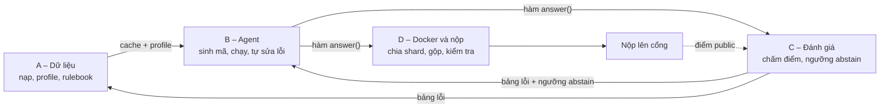

# Kế hoạch chia việc cuối cùng – DataMate (Zalo AI Challenge 2026)

> Nhóm 4 thành viên: **A, B, C, D** (thay bằng tên thật).
> Giai đoạn: **Public Test (26/10 – 16/11)**, tối đa **5 lượt nộp/ngày**. Nộp Docker trước **23:59 (GMT+7) ngày 16/11**.
> Private test: công bố 9:00 ngày 20/11, hạn nộp kết quả 23:59 ngày 23/11.

---

## 0. Sơ đồ tổng quan

> Các sơ đồ dùng cú pháp Mermaid (GitHub, GitLab, VS Code, Obsidian đều hiển thị được).

### 0.1. Luồng chạy và nộp bài (giai đoạn Public Test)



Cả 4 máy dùng **cùng một code, một model, một Docker**.

### 0.2. Ai giao gì cho ai



- A giao **cache + profile** (giao sớm 3–5 business nhỏ để B bắt đầu ngay).
- B giao **hàm `answer()`** cho C (chấm trên Train) và D (chạy Public Test).
- C gửi **bảng lỗi** cho A và B, kèm **ngưỡng abstain** cho B.
- D nộp bài; điểm public quay lại C để bắt đầu vòng sửa tiếp theo.

---

## 1. Hiểu đúng bài toán và dữ liệu

| Gói | Số business | Câu hỏi | Có đáp án | Dùng để |
|---|---|---|---|---|
| **Train** | 30 | ~3.000 | Có (`answers.jsonl`) | Phát triển, sửa lỗi, few-shot, fine-tune, chấm điểm cục bộ |
| **Public Test** | 10–20 | ~1.000 | Không (ẩn) | Chạy suy luận rồi nộp để xem điểm public |
| **Private Test** | 10–20 | ~500 | Không (ẩn) | Điểm cuối; có loại business mới |

Điểm cần nhớ:

- Mỗi gói có thư mục `data/<business_id>/`, `rulebook.md`, `calendar.csv`, `questions.jsonl` riêng. `business_id` trong câu hỏi **trùng tên thư mục** trong `data/` (ví dụ `dev_002` ↔ `data/dev_002/`).
- **Rulebook có thể khác giữa các gói** → phải đọc rulebook của đúng gói đang chạy.
- Mỗi câu có `as_of_date` riêng, kể cả cùng một business → quy đổi "hôm nay", "tuần rồi", "tháng này" theo từng câu.
- Câu hỏi viết tự nhiên, có thể viết tắt, không dấu, gõ sai.
- Chấm điểm PA: đúng **+1**, abstain **0**, sai **−1** (trả lời cho câu unanswerable cũng tính sai) → cần cơ chế abstain/unanswerable.
- Số "130 business": cần **kiểm tra lại** bằng cách đếm thư mục trong `data/` của từng gói. Số cần chia cho 4 máy khi nộp public test chỉ là số business của gói Public Test.

---

## 2. Nguyên tắc làm việc chung

1. **Chia việc theo vai trò** khi viết code; **chia theo shard** chỉ cho các lần chạy nặng (nạp dữ liệu, suy luận, đánh giá).
2. **Một code, một model, một Docker image** cho cả nhóm. Không ai tự train hay sửa riêng một bản. Nếu fine-tune thì **một người, một lần**, rồi chia model cho cả nhóm.
3. **Chỉ dùng Train** để học/few-shot/fine-tune. **Cấm** dùng Public/Private test để huấn luyện hay thu thập đáp án (Luật 6).
4. **Cấm** hard-code theo `id` câu hỏi hoặc `business_id` (Luật 4).
5. **Không nạp file lớn vào pandas**: chuyển sang Parquet/DuckDB một lần; agent chỉ truy vấn qua DuckDB và chỉ thấy "thẻ schema" tóm tắt.
6. Mỗi lần chạy ghi lại **commit hash**, model, phiên bản prompt.
7. Làm sớm một **vòng chạy hoàn chỉnh** (dù điểm thấp), rồi cải thiện dần. Không chờ hoàn hảo mới nộp.

---

## 3. Hợp đồng giao diện (chốt trong vài giờ đầu để làm song song)

| Hạng mục | Nội dung | Người chốt |
|---|---|---|
| Cấu trúc cache | `cache/<business_id>/db.duckdb` + `profile.json` | A |
| Schema `profile.json` | bảng, cột, kiểu, khoảng ngày, khóa, ghi chú dữ liệu bẩn, quy tắc rút từ README/rulebook | A |
| Hàm chính | `answer(question, business_id, as_of) -> {type, answer, confidence, trace}` | B |
| Định dạng log | tối thiểu: id câu hỏi, câu trả lời cuối, thời gian; thêm mã sinh ra, kết quả thực thi | D |
| `shards.json` | danh sách business của từng shard (cố định, không chia tay) | A + D |
| Kết quả shard | `submission_shard_<k>.jsonl` cùng schema với `submission.jsonl` | D |

---

## 4. Phân vai

### A – Data & Profiling
- Pipeline nạp mọi định dạng (.csv, .xlsx, .sqlite) sang DuckDB/Parquet, xử lý song song, tiết kiệm bộ nhớ.
- Sinh `profile.json` và thẻ schema ngắn cho từng business.
- Parse `README.md` (chất lượng không đồng đều) và `rulebook.md` thành quy tắc có cấu trúc.
- Module thời gian: as-of date, tuần Thứ Hai–Chủ nhật, "tháng này" (đến hết ngày as-of), "tuần rồi", "cùng kỳ năm ngoái", cửa sổ Tết (23 tháng Chạp – mùng 10, dùng `calendar.csv`).
- Phát hiện dữ liệu bẩn: tên trùng/viết khác nhau, ngày–tiền lẫn định dạng, đơn hủy, đơn có hàng trả lại.
- Tạo `shards.json` cân bằng theo **dung lượng file × số câu hỏi** của từng business.
- **Giao ngay** 3–5 business đã nạp (ưu tiên business nhỏ) cho B và C, trong khi phần còn lại chạy nền.

### B – Agent Core
- Pipeline: câu hỏi → sinh mã (SQL/pandas) → chạy sandbox → tự sửa lỗi → chuẩn hóa kiểu đầu ra (number, percent, string, date, boolean, list, table).
- Chọn và benchmark model (tổng tham số ≤ 15 tỷ, trọng số công khai trước 1/10/2026), chạy bằng vLLM.
- Prompt hệ thống; few-shot truy xuất từ câu hỏi Train tương tự; ưu tiên dùng thư viện/framework có sẵn thay vì tự viết.
- Xử lý câu hỏi mơ hồ, viết tắt, không dấu; đề xuất `unanswerable` khi dữ liệu không đủ.
- **Giao sớm** hàm `answer()` bản đầu cho C và D.

### C – Evaluation & Calibration
- Scorer **đúng theo luật**: chuẩn hóa string (NFC, lowercase, thay ký tự không phải chữ/số/khoảng trắng bằng khoảng trắng, gộp khoảng trắng, **giữ dấu tiếng Việt**), alias, làm tròn number/percent, khớp list theo vị trí, khớp table (cột theo tên, hàng như tập hợp).
- Chạy trên 30 business Train, lập **bảng lỗi theo loại câu hỏi** (xếp hạng, so sánh kỳ, tồn kho, công nợ, hạn dùng...), gửi A và B mỗi ngày.
- Tạo dữ liệu tổng hợp (câu hỏi → mã) cho few-shot/fine-tune.
- Xây bộ phát hiện unanswerable và **ngưỡng abstain** (ví dụ self-consistency: sinh nhiều lần, so sánh kết quả; tin cậy thấp thì abstain).
- Giữ vài business Train làm "chưa từng thấy" để đo khả năng tổng quát cho private test.

### D – Infra & Submission
- Script chia `questions.jsonl` theo `shards.json` (xem mục 5) và script gộp + kiểm tra file nộp.
- Docker: base image theo hướng dẫn BTC, CUDA ≥ 12.8, PyTorch/vLLM tương thích Blackwell.
- `predict.sh`: đọc `/data`, ghi `/result/submission.jsonl` và log từng câu vào `/result/logs/`.
- Kiểm tra chạy **offline**, thư mục dữ liệu **chỉ đọc**, file tạm ghi chỗ khác.
- Đo thời gian toàn pipeline trên 1 shard rồi ước tính cho toàn bộ test so với **6 giờ** (tính cả nạp dữ liệu và nạp model).
- Tính tất định: temperature 0, seed cố định, khóa phiên bản thư viện.
- Quản lý lịch nộp; chuẩn bị checksum + link Google Drive cho gói Docker.

---

## 5. Chia business cho 4 máy (chỉ cho các lần chạy nặng)

**Khi nào dùng**: nạp/profile dữ liệu, chạy suy luận, chạy đánh giá.
**Khi nào không dùng**: viết/sửa code, fine-tune model.

### Cách chia
1. Tính "độ nặng" mỗi business = dung lượng file × số câu hỏi của business đó.
2. Ghép business vào 4 shard sao cho tổng độ nặng xấp xỉ nhau, ghi vào `shards.json`.
3. Với mỗi dòng của `questions.jsonl`, tra `business_id` để biết shard, ghi vào `questions_shard_<k>.jsonl`.
4. Mỗi máy chỉ lấy dữ liệu của business thuộc shard mình và file câu hỏi của shard mình.
5. Mỗi máy ghi `submission_shard_<k>.jsonl`; D gộp thành `submission.jsonl`.

Khung chia câu hỏi (đặt trong module riêng, ví dụ `split_questions`):

```python
import json
from collections import defaultdict

shards = json.load(open("shards.json"))
biz_to_shard = {b: s for s, bizs in shards.items() for b in bizs}

out = defaultdict(list)
for line in open("questions.jsonl", encoding="utf-8"):
    q = json.loads(line)
    out[biz_to_shard[q["business_id"]]].append(line)

for shard, lines in out.items():
    open(f"questions_{shard}.jsonl", "w", encoding="utf-8").writelines(lines)
```

### Kiểm tra sau khi chia
- Tổng số câu của 4 shard bằng số dòng `questions.jsonl` gốc; mỗi `id` chỉ nằm ở một shard.
- Mọi `business_id` trong câu hỏi đều có trong `shards.json`.
- Số `business_id` khác nhau trong `questions.jsonl` bằng số thư mục trong `data/`.

### Đồng nhất giữa các máy
Cùng commit git, cùng Docker image / phiên bản vLLM–PyTorch–CUDA, cùng model, prompt, temperature 0, seed.

---

## 6. Lưu trữ

| Thứ | Ai làm | Lưu ở đâu | Vào Docker? |
|---|---|---|---|
| Bản sơ chế từng business (cache) | 4 người theo shard | Ổ chung của nhóm (NAS/Drive/repo private), mỗi người ghi vào thư mục business của mình, kèm commit hash | **Không** – phải tự tạo lại lúc chạy thật |
| Model fine-tune (nếu có) | 1 người | Ổ chung rồi vào Docker | Có |
| Code, prompt, few-shot từ Train | Cả nhóm | Git | Có |
| Kết quả shard | 4 người | Gộp thành 1 `submission.jsonl` | Không (chỉ để nộp public test) |

**Quan trọng**: khi nộp Docker, BTC mount dữ liệu test vào `/data` và chạy `predict.sh` trên **một máy** trong **6 giờ**. Bước nạp và sơ chế dữ liệu phải chạy **ngay trong `predict.sh`** và tính vào 6 giờ. Việc chia 4 máy chỉ để chạy thử và nộp public test.

---

## 7. Lộ trình

### Giai đoạn 1 – Có vòng chạy hoàn chỉnh đầu tiên (27/10 – 29/10)
Mục tiêu: một `submission.jsonl` hợp lệ trên Public Test, chưa cần tốt.

| Người | Việc |
|---|---|
| A | Chốt schema profile; nạp 3–5 business nhỏ trước, giao cho B/C; nạp phần còn lại chạy nền; tạo `shards.json` |
| B | Agent đơn giản nhất (sinh SQL → chạy → trả kết quả) với model có sẵn |
| C | Viết scorer; chạy baseline trên vài business Train |
| D | Script chia câu hỏi, script gộp + kiểm tra; Docker rỗng chạy được `predict.sh`; **nộp lượt đầu** để biết mốc xuất phát |

### Giai đoạn 2 – Cải thiện theo lỗi (30/10 – 10/11)

| Người | Việc |
|---|---|
| A | Sửa dữ liệu bẩn và quy tắc theo lỗi C báo |
| B | Tự sửa lỗi, few-shot, tối ưu prompt, chọn model theo bảng lỗi |
| C | Bảng lỗi hằng ngày; dữ liệu tổng hợp; hiệu chỉnh ngưỡng abstain/unanswerable |
| D | Log, kiểm tra offline, đo thời gian, tối ưu thông lượng, tính tất định |

### Giai đoạn 3 – Đóng băng và đóng gói (11/11 – 16/11)

| Ngày | Việc |
|---|---|
| 11–13/11 | A đóng băng pipeline nạp; B đóng băng model và prompt; C chạy kiểm tra hồi quy cuối |
| 14–15/11 | D build Docker bản cuối, chạy offline đầy đủ, chạy lặp 2 lần để kiểm tra tính tất định |
| 16/11 | **Nộp Docker trước 23:59 (GMT+7)** kèm checksum + link Drive (tối đa 2 lần, chỉ lần cuối được chấm) |

### Private test (20/11 – 23/11)
Công bố 9:00 ngày 20/11 → chạy giải pháp đã đóng băng → nộp kết quả trước 23:59 ngày 23/11.

---

## 8. Phân bổ 5 lượt nộp mỗi ngày

| Lượt | Mục đích |
|---|---|
| 1–3 | Thí nghiệm có chủ đích: **mỗi lượt chỉ đổi một thứ** |
| 4 | Hồi quy: nộp lại bản tốt nhất để chắc điểm không tụt |
| 5 | Dự phòng cho lỗi bất ngờ |

Ghi lại mỗi lượt: ngày giờ, commit, thay đổi, điểm. Điểm public chỉ để **tham khảo**; điểm đo trên Train của C là thước đo chính. Các nhóm khác nộp sớm hay có điểm cao ở public **không quyết định** xếp hạng cuối, vì điểm cuối là lần chạy lại Docker trên private test.

---

## 9. Quy trình hằng ngày

1. **Đầu ngày (10 phút)**: C báo bảng lỗi hôm qua; cả nhóm chọn tối đa 3 thay đổi cần thử.
2. **Trong ngày**: mỗi người làm phần của mình trên nhánh git riêng; merge qua pull request; D khóa phiên bản trước khi chạy shard.
3. **Chiều/tối**: chạy 4 shard song song → D gộp và kiểm tra → nộp theo kế hoạch 5 lượt.
4. **Cuối ngày**: ghi kết quả vào nhật ký nộp bài, cập nhật bảng lỗi.

---

## 10. Rủi ro và cách xử lý

| Rủi ro | Cách xử lý |
|---|---|
| Quá 6 giờ trên máy chấm | D đo sớm; nạp dữ liệu song song; model nhỏ/lượng tử hóa; ghi kết quả dần vào `submission.jsonl` (phần chưa kịp bị tính abstain) |
| Rulebook khác giữa các gói | A đọc rulebook của đúng gói, không gán cứng theo Train |
| Business loại mới ở private test | C giữ business Train "chưa từng thấy" để kiểm tra; không viết logic riêng theo loại business |
| Hai lần chạy lệch > 0,03 PA | Cố định seed, temperature 0, phiên bản thư viện; chạy lặp để kiểm tra |
| Trả lời sai bị −1 | C hiệu chỉnh ngưỡng abstain/unanswerable |
| Code lệch giữa các thành viên | Một repo, một Docker image, commit hash ghi trong log |
| Vi phạm luật dữ liệu | Không dùng test để train; không thu thập đáp án test; khai báo model trong README |
| Business sót khi chia shard | Chạy các bước kiểm tra ở mục 5 trước mỗi lần nộp |

---

## 11. Checklist trước khi nộp Docker (16/11)

- [ ] `predict.sh` đọc `/data`, ghi `/result/submission.jsonl` và `/result/logs/`
- [ ] Bước nạp dữ liệu chạy trong `predict.sh`, không phụ thuộc cache dựng sẵn
- [ ] Chạy được với **mạng tắt**
- [ ] Thư mục dữ liệu mount **chỉ đọc**
- [ ] Model khai báo trong README, tổng tham số ≤ 15 tỷ, trọng số công khai trước 1/10/2026
- [ ] Ước tính thời gian toàn bộ test < 6 giờ (kể cả nạp model và nạp dữ liệu)
- [ ] Chạy lặp 2 lần cho kết quả khớp (|ΔPA| ≤ 0,03)
- [ ] Không có logic theo `id` câu hỏi hoặc `business_id`
- [ ] Đọc rulebook của đúng split lúc chạy
- [ ] Checksum + link Google Drive công khai
- [ ] Nộp trước **23:59 (GMT+7)** ngày 16/11

---

## 12. Cấu trúc project đề xuất

Nguyên tắc: **mỗi file một việc, mỗi thư mục một mối quan tâm**, không gom nhiều thứ vào một file lớn. Mỗi thành viên sở hữu các thư mục của mình nên ít khi sửa trùng file (ít xung đột khi merge).

```
datamate/
├── README.md                      # khai báo model, cách chạy, cách nộp (D)
├── pyproject.toml                 # khóa phiên bản thư viện (D)
├── Dockerfile                     # (D)
├── predict.sh                     # đọc /data, ghi /result/submission.jsonl (D)
├── .gitignore                     # bỏ data/, cache/, outputs/, trọng số model
│
├── configs/
│   ├── paths.yaml                 # đường dẫn data, cache, output
│   ├── model.yaml                 # model, tham số vLLM, temperature 0, seed
│   └── agent.yaml                 # số lần tự sửa lỗi, timeout sandbox
│
├── src/datamate/
│   ├── contracts/                 # HỢP ĐỒNG GIAO DIỆN – cả nhóm cùng đọc, hiếm khi sửa
│   │   ├── question.py            # Question: id, business_id, question, as_of_date
│   │   ├── answer.py              # Answer: type, answer, confidence, trace
│   │   └── profile.py             # BusinessProfile: bảng, cột, kiểu, khoảng ngày
│   │
│   ├── ingestion/                 # (A) nạp dữ liệu thô
│   │   ├── readers/
│   │   │   ├── csv_reader.py
│   │   │   ├── xlsx_reader.py
│   │   │   └── sqlite_reader.py
│   │   ├── to_duckdb.py           # ghi cache/<business_id>/db.duckdb
│   │   ├── profiler.py            # sinh profile.json
│   │   ├── schema_card.py         # thẻ schema ngắn đưa cho agent
│   │   └── dirty_data.py          # tên trùng, ngày–tiền lẫn lộn, đơn hủy/trả hàng
│   │
│   ├── rules/                     # (A) quy tắc nghiệp vụ
│   │   ├── rulebook_parser.py     # đọc rulebook.md của đúng split
│   │   ├── readme_parser.py       # đọc README.md của từng business
│   │   └── rule_models.py         # doanh thu, bán chạy, giá vốn, tuần, tháng...
│   │
│   ├── timeparse/                 # (A) quy đổi thời gian theo as_of_date
│   │   ├── as_of.py
│   │   ├── week_month.py          # tuần Thứ Hai–Chủ nhật, tháng này, tuần rồi
│   │   ├── same_period.py         # cùng kỳ năm ngoái
│   │   └── lunar_tet.py           # cửa sổ Tết từ calendar.csv
│   │
│   ├── agent/                     # (B) agent
│   │   ├── graph.py               # workflow LangGraph nối các node
│   │   ├── nodes/
│   │   │   ├── understand.py      # chuẩn hóa câu hỏi viết tắt/không dấu
│   │   │   ├── generate_code.py   # sinh SQL/pandas
│   │   │   ├── execute.py         # chạy trong sandbox
│   │   │   ├── self_correct.py    # sửa lỗi khi chạy fail
│   │   │   └── format_answer.py   # ép về đúng kiểu đầu ra
│   │   ├── prompts/
│   │   │   ├── system.md
│   │   │   └── fewshot_template.md
│   │   ├── retriever/
│   │   │   └── fewshot_retriever.py   # lấy ví dụ Train tương tự
│   │   ├── sandbox/
│   │   │   └── duckdb_runner.py   # chỉ đọc, có timeout
│   │   └── llm/
│   │       └── vllm_client.py
│   │
│   ├── answer_types/              # (B) mỗi kiểu một file
│   │   ├── number.py
│   │   ├── percent.py
│   │   ├── string.py
│   │   ├── date.py
│   │   ├── boolean.py
│   │   ├── list.py
│   │   ├── table.py
│   │   └── unanswerable.py
│   │
│   ├── calibration/               # (C) abstain / unanswerable
│   │   ├── confidence.py
│   │   ├── self_consistency.py    # sinh nhiều lần, so sánh kết quả
│   │   └── abstain_policy.py
│   │
│   ├── evaluation/                # (C) chấm điểm đúng luật cuộc thi
│   │   ├── normalize.py           # NFC, lowercase, bỏ ký tự lạ, gộp khoảng trắng
│   │   ├── matchers/              # mỗi kiểu một file
│   │   │   ├── number_match.py
│   │   │   ├── percent_match.py
│   │   │   ├── string_match.py
│   │   │   ├── date_match.py
│   │   │   ├── list_match.py
│   │   │   └── table_match.py
│   │   ├── scorer.py              # PA: +1 đúng, 0 abstain, −1 sai
│   │   └── error_report.py        # bảng lỗi theo loại câu hỏi
│   │
│   ├── synthetic/                 # (C) dữ liệu tổng hợp từ Train
│   │   └── build_examples.py
│   │
│   ├── sharding/                  # (D, phối hợp A)
│   │   ├── plan_shards.py         # dung lượng × số câu hỏi → shards.json
│   │   ├── split_questions.py     # chia questions.jsonl theo business_id
│   │   ├── merge_submissions.py   # gộp submission_shard_k.jsonl
│   │   └── validate_submission.py # đủ id, không trùng, đúng kiểu
│   │
│   ├── pipeline/                  # (D)
│   │   ├── run_business.py        # chạy 1 business
│   │   └── run_all.py             # dùng trong predict.sh
│   │
│   └── run_logging/               # (D)
│       └── run_logger.py          # log từng câu vào /result/logs/
│
├── scripts/                       # lệnh chạy nhanh cho từng giai đoạn
│   ├── ingest_shard.sh            # A: nạp dữ liệu của 1 shard
│   ├── eval_train.sh              # C: chấm trên Train
│   ├── run_shard.sh               # chạy suy luận 1 shard
│   └── make_submission.sh         # D: gộp + kiểm tra
│
├── data/                          # KHÔNG đưa lên git
│   ├── train/
│   ├── public_test/
│   └── private_test/
├── cache/                         # KHÔNG đưa lên git: <business_id>/db.duckdb + profile.json
├── outputs/                       # KHÔNG đưa lên git
│   ├── shards/                    # shards.json, questions_shard_k.jsonl
│   ├── submissions/               # submission_shard_k.jsonl, submission.jsonl
│   ├── logs/
│   └── reports/                   # bảng lỗi của C theo ngày
│
├── tests/                         # mỗi module có thư mục test riêng (pytest)
│   ├── ingestion/
│   ├── timeparse/
│   ├── evaluation/
│   └── sharding/
│
└── docs/
    ├── task_division.md           # file kế hoạch này
    └── submission_log.md          # nhật ký nộp: ngày giờ, commit, thay đổi, điểm
```

### Ai sở hữu thư mục nào

| Thành viên | Thư mục sở hữu |
|---|---|
| **A** | `ingestion/`, `rules/`, `timeparse/` |
| **B** | `agent/`, `answer_types/`, `configs/model.yaml`, `configs/agent.yaml` |
| **C** | `evaluation/`, `calibration/`, `synthetic/`, `outputs/reports/` |
| **D** | `sharding/`, `pipeline/`, `run_logging/`, `Dockerfile`, `predict.sh`, `scripts/` |
| **Chung** | `contracts/` (sửa phải báo cả nhóm), `configs/paths.yaml`, `tests/`, `docs/` |

### Thư viện có sẵn nên dùng (không tự viết lại)

| Việc | Nên dùng |
|---|---|
| Truy vấn dữ liệu lớn | DuckDB, Parquet |
| Đọc xlsx nhanh | calamine (python-calamine) hoặc openpyxl chế độ read-only |
| Workflow agent | LangGraph |
| Chạy LLM | vLLM |
| Kiểm tra dữ liệu vào/ra | Pydantic (dùng cho `contracts/`) |
| Truy xuất few-shot | embedding model nhỏ + FAISS hoặc thành phần retriever của LangChain |
| Cấu hình | YAML + Pydantic Settings |
| Test | pytest |

Mọi model dùng (kể cả embedding, reranker) phải được **khai báo trong README** và tính vào giới hạn **15 tỷ tham số**.

### Quy ước git

- Nhánh: `feat/<vai>-<việc>` (ví dụ `feat/A-xlsx-reader`); merge vào `main` qua pull request, có ít nhất một người xem.
- Sửa `contracts/` phải **báo cả nhóm trước**, vì mọi người phụ thuộc vào nó.
- Mỗi lần chạy shard hoặc nộp bài ghi **commit hash** vào `docs/submission_log.md`.
- Không commit `data/`, `cache/`, `outputs/` và trọng số model; chia sẻ chúng qua ổ chung của nhóm.